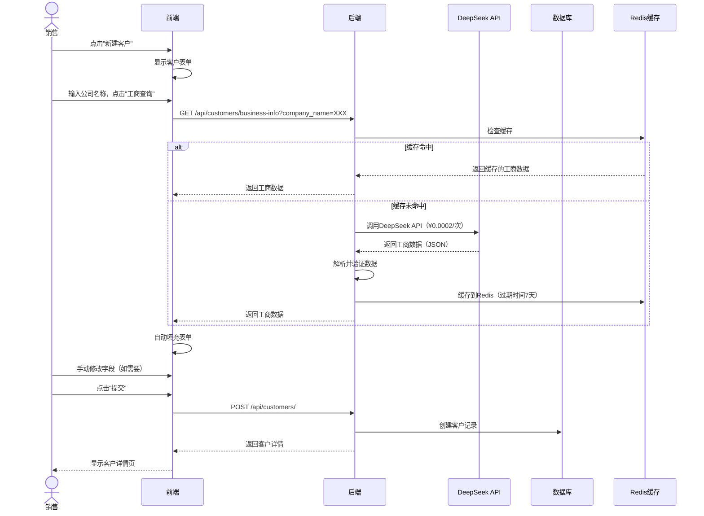
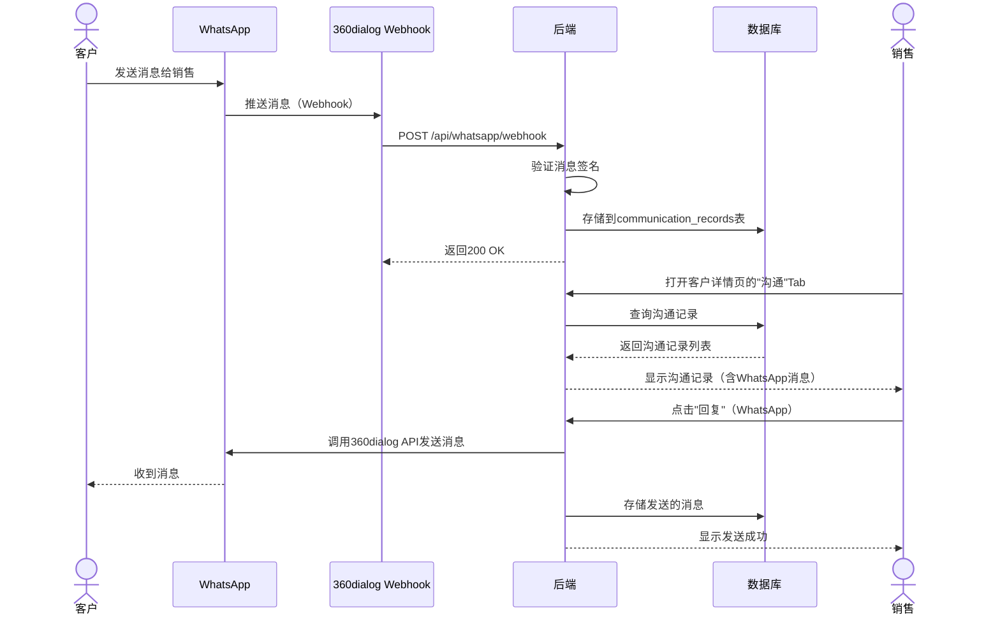
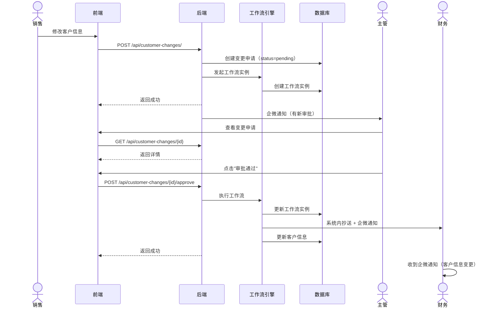
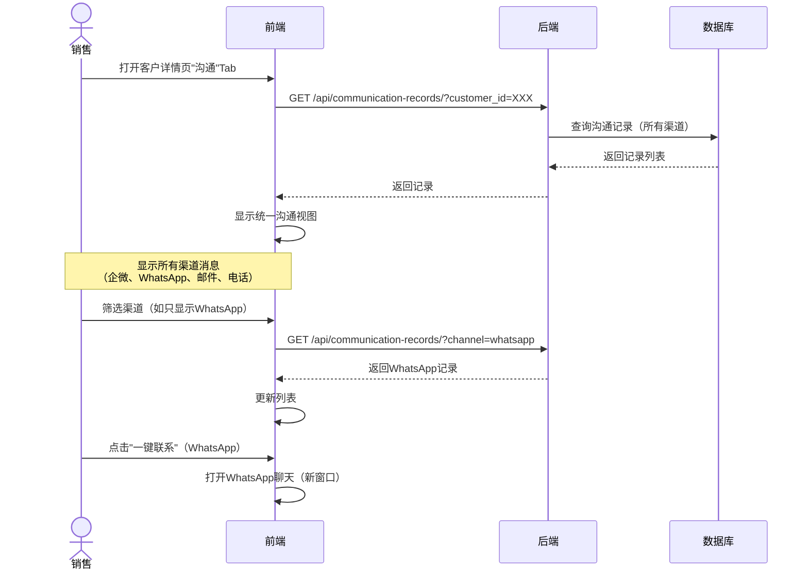
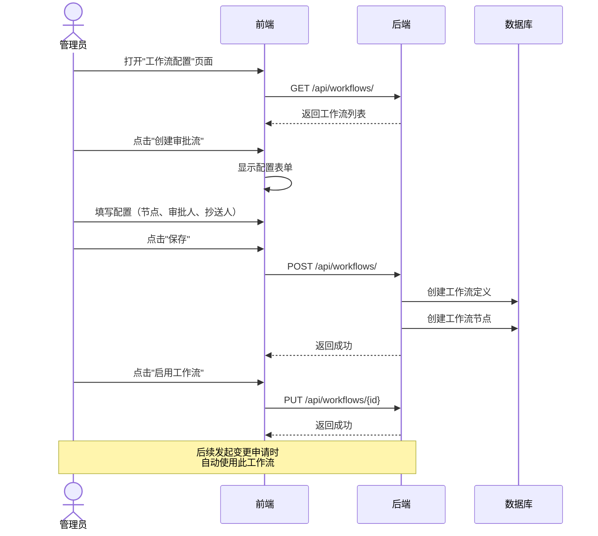
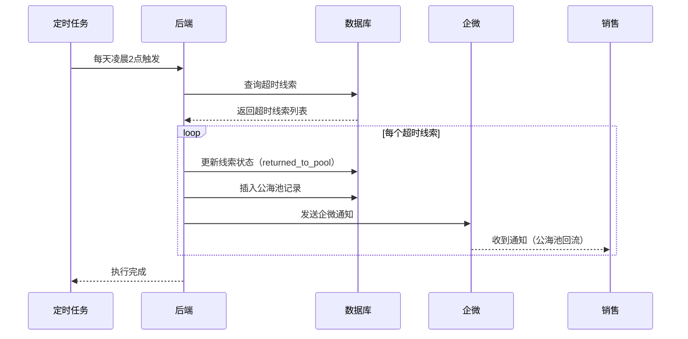

# HOLANG CRM Phase 1 系统架构设计 v2.0 - Part 4: 程序调用流程

**文档版本**: v2.0  
**创建日期**: 2025-01-15  
**作者**: Bob（软件架构师）  
**状态**: 待审核

---

## 4. 程序调用流程

### 4.1 内销客户创建流程（含DeepSeek工商查询）

---

### 4.2 外销客户WhatsApp消息同步流程

---

### 4.3 客户信息变更审批流（接入工作流引擎）

---

### 4.4 统一沟通视图展示流程

---

### 4.5 低代码配置工作流流程

---

### 4.6 线索公海池自动回流流程

---

**继续阅读**: [Part 5: 任务分解](./system_design_part5_tasks.md)
