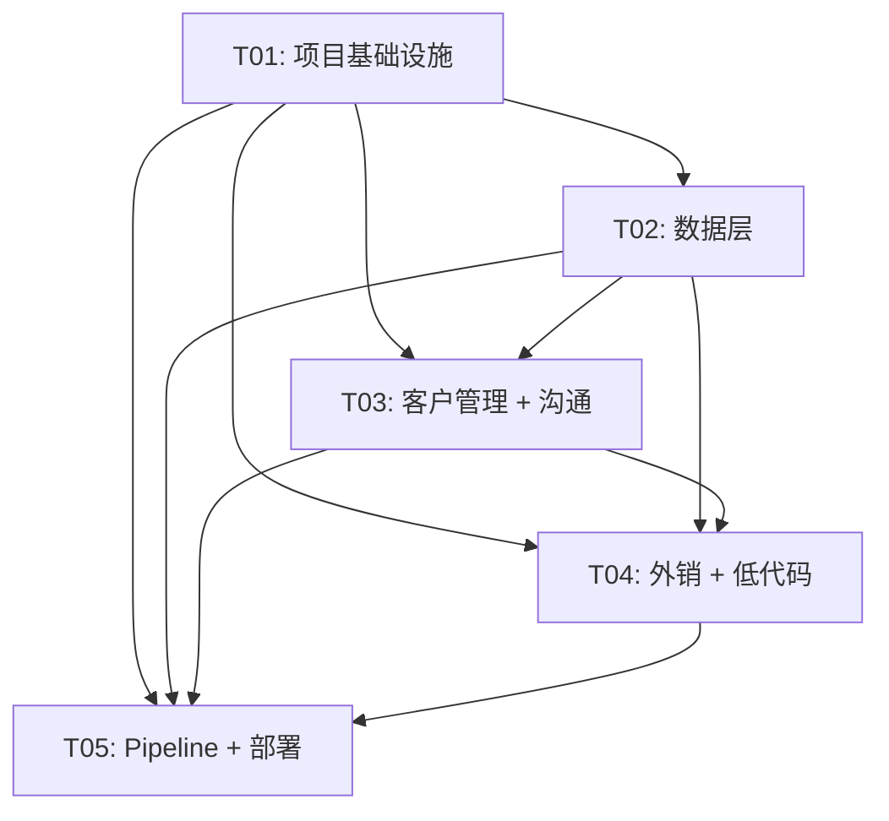

# HOLANG CRM Phase 1 系统架构设计 v2.0 - Part 5: 任务分解

**文档版本**: v2.0  
**创建日期**: 2025-01-15  
**作者**: Bob（软件架构师）  
**状态**: 待审核

---

## 7. 任务分解（v2.0）

### 任务划分说明（v2.0更新）

由于v2.0新增了多个模块（WhatsApp集成、统一沟通视图、低代码配置引擎），任务划分需要调整：

1. **T01（项目基础设施）**：不变
2. **T02（数据层）**：增加新模型（communication_record、workflow等）
3. **T03（客户管理 + 沟通记录）**：客户管理 + 统一沟通视图
4. **T04（外销模块 + 低代码引擎）**：WhatsApp集成 + 邮件同步 + 工作流引擎
5. **T05（Pipeline + 合同 + 周报 + 部署）**：不变

**任务数量**：仍然是5个任务（符合≤5个任务的要求）

---

### T01: 项目基础设施

**任务ID**: T01  
**任务名称**: 项目初始化 + 基础设施配置  
**依赖**: 无  
**优先级**: P0  
**预估工时**: 2天

**涉及文件（20个）**:

**前端基础设施（10个）**:
- `frontend/package.json` - 项目配置（含WhatsApp依赖）
- `frontend/vite.config.ts` - Vite配置
- `frontend/src/main.ts` - 入口文件
- `frontend/src/router/index.ts` - 路由配置（内销/外销菜单）
- `frontend/Dockerfile` - 前端容器配置
- 其他配置文件（tsconfig.json、env.development等）

**后端基础设施（10个）**:
- `backend/requirements.txt` - Python依赖（含WhatsApp、邮件依赖）
- `backend/app/main.py` - FastAPI应用入口
- `backend/app/config.py` - 配置（数据库、Redis、DeepSeek、WhatsApp）
- `docker-compose.yml` - Docker Compose配置
- `nginx.conf` - Nginx配置
- 其他配置文件

**任务内容**:
1. 初始化前端项目（Vue 3 + Vite + TypeScript + Element Plus）
2. 初始化后端项目（FastAPI + SQLAlchemy + Alembic）
3. 配置Docker Compose（前端 + 后端 + PostgreSQL + Redis）
4. 配置Nginx（反向代理、静态文件）
5. 配置环境变量（开发/生产）
6. **新增（v2.0）**：配置WhatsApp Business API（360dialog）
7. **新增（v2.0）**：配置邮件IMAP/SMTP

**验收标准**:
- [ ] 前端项目可以正常启动
- [ ] 后端项目可以正常启动
- [ ] 数据库可以正常连接
- [ ] Docker Compose可以正常启动
- [ ] **新增（v2.0）**：WhatsApp Business API可以正常调用
- [ ] **新增（v2.0）**：邮件可以正常同步

---

### T02: 数据层（数据库模型 + API框架）

**任务ID**: T02  
**任务名称**: 数据库模型设计 + API路由框架  
**依赖**: T01  
**优先级**: P0  
**预估工时**: 3天

**涉及文件（30个）**:

**数据模型（15个）**:
- `backend/app/models/user.py` - 用户模型（含sales_type、whatsapp_account）
- `backend/app/models/customer.py` - 客户模型（含sales_type、工商数据字段）
- `backend/app/models/communication_record.py` - 沟通记录模型（新增）
- `backend/app/models/workflow.py` - 工作流定义模型（新增）
- `backend/app/models/workflow_node.py` - 工作流节点模型（新增）
- `backend/app/models/workflow_instance.py` - 工作流实例模型（新增）
- 其他模型（contact、opportunity、contract等）

**验证模型（15个）**:
- `backend/app/schemas/user.py` - 用户验证模型
- `backend/app/schemas/communication_record.py` - 沟通记录验证模型（新增）
- `backend/app/schemas/workflow.py` - 工作流验证模型（新增）
- 其他验证模型

**任务内容**:
1. 定义所有数据库模型（含新增的5个模型）
2. 创建Pydantic验证模型（Schemas）
3. 实现API路由框架（CRUD接口）
4. 配置数据库迁移（Alembic）
5. **新增（v2.0）**：实现沟通记录API框架
6. **新增（v2.0）**：实现工作流引擎API框架

**验收标准**:
- [ ] 所有数据库模型可以成功创建表
- [ ] 沟通记录API可以正常工作
- [ ] 工作流引擎API可以正常工作
- [ ] 前端类型定义完整

---

### T03: 客户管理 + 统一沟通视图

**任务ID**: T03  
**任务名称**: 客户管理完整功能 + 统一沟通视图  
**依赖**: T01, T02  
**优先级**: P0  
**预估工时**: 5天

**涉及文件（40个）**:

**前端 - 客户管理（15个文件）**:
- `frontend/src/pages/customer/CustomerListPage.vue` - 客户列表页
- `frontend/src/pages/customer/CustomerDetailPage.vue` - 客户详情页（含"沟通"Tab）
- `frontend/src/pages/customer/CustomerFormPage.vue` - 客户表单（含DeepSeek查询）
- `frontend/src/components/communication/CommunicationTab.vue` - 沟通Tab
- 其他组件

**前端 - 沟通记录（10个文件）**:
- `frontend/src/pages/communication/UnifiedCommunicationPage.vue` - 统一沟通视图
- `frontend/src/components/whatsapp/WhatsAppChatBox.vue` - WhatsApp聊天框
- `frontend/src/components/email/EmailInboxList.vue` - 邮件收件箱
- 其他组件

**后端 - 服务和API（15个文件）**:
- `backend/app/services/customer_service.py` - 客户业务逻辑
- `backend/app/services/communication_service.py` - 沟通记录服务
- `backend/app/services/ai_service.py` - DeepSeek工商查询服务
- `backend/app/api/customers.py` - 客户API
- `backend/app/api/communication_records.py` - 沟通记录API
- 其他服务和API

**任务内容**:
1. 实现客户管理完整功能
2. 实现DeepSeek工商数据解析
3. 实现客户信息变更审批流（接入工作流引擎）
4. **新增（v2.0）**：实现统一沟通视图
5. **新增（v2.0）**：实现WhatsApp集成（绑定、同步、发送）
6. **新增（v2.0）**：实现邮件集成（同步、发送）
7. **新增（v2.0）**：实现一键联系功能

**验收标准**:
- [ ] 客户可以成功创建、更新、删除
- [ ] DeepSeek工商查询可以正常工作
- [ ] 客户信息变更审批流可以正常工作
- [ ] **新增（v2.0）**：统一沟通视图可以正常显示
- [ ] **新增（v2.0）**：WhatsApp消息可以正常同步和发送
- [ ] **新增（v2.0）**：邮件可以正常同步和发送

---

### T04: 外销模块 + 低代码配置引擎

**任务ID**: T04  
**任务名称**: 外销特有功能 + 低代码配置引擎  
**依赖**: T01, T02, T03  
**优先级**: P0  
**预估工时**: 5天

**涉及文件（35个）**:

**前端 - 外销模块（15个文件）**:
- `frontend/src/pages/whatsapp/WhatsAppBindPage.vue` - WhatsApp绑定页
- `frontend/src/pages/whatsapp/WhatsAppChatPage.vue` - WhatsApp聊天页
- `frontend/src/pages/email/EmailInboxPage.vue` - 邮件收件箱页
- `frontend/src/pages/admin/WorkflowConfigPage.vue` - 工作流配置页
- 其他页面和组件

**后端 - 工作流引擎和集成服务（10个文件）**:
- `backend/app/services/workflow_engine.py` - 工作流引擎服务
- `backend/app/services/whatsapp_service.py` - WhatsApp同步服务
- `backend/app/services/email_service.py` - 邮件同步服务
- `backend/app/api/workflows.py` - 工作流API
- `backend/app/api/whatsapp.py` - WhatsApp API
- 其他服务和API

**任务内容**:
1. **新增（v2.0）**：实现WhatsApp集成（绑定、同步、发送、Webhook）
2. **新增（v2.0）**：实现邮件集成（IMAP同步、SMTP发送）
3. **新增（v2.0）**：实现低代码配置引擎（工作流配置）
4. **新增（v2.0）**：实现审批流通知财务
5. 实现外销客户详情页
6. 实现定时任务（WhatsApp消息同步、邮件同步）

**验收标准**:
- [ ] **新增（v2.0）**：WhatsApp可以正常绑定、同步、发送
- [ ] **新增（v2.0）**：邮件可以正常同步和发送
- [ ] **新增（v2.0）**：工作流引擎可以正常执行
- [ ] **新增（v2.0）**：管理员可以配置工作流
- [ ] **新增（v2.0）**：审批通过后财务可以收到通知

---

### T05: Pipeline + 合同 + 周报 + 部署

**任务ID**: T05  
**任务名称**: Pipeline看板 + 合同管理 + 周报 + 部署  
**依赖**: T01, T02, T03, T04  
**优先级**: P0  
**预估工时**: 4天

**涉及文件（30个）**:

**前端 - Pipeline、合同、周报（25个文件）**:
- `frontend/src/pages/PipelinePage.vue` - Pipeline看板页
- `frontend/src/pages/contract/ContractListPage.vue` - 合同列表页
- `frontend/src/pages/weekly-report/WeeklyReportListPage.vue` - 周报列表页
- 其他页面和组件

**后端 - 服务（5个文件）**:
- `backend/app/services/opportunity_service.py` - 商机服务
- `backend/app/services/contract_service.py` - 合同服务
- `backend/app/services/weekly_report_service.py` - 周报服务
- 其他服务

**部署配置（12个文件）**:
- `docker-compose.yml` - Docker Compose配置
- `nginx.conf` - Nginx配置
- `deploy.sh` - 部署脚本
- 其他配置文件

**任务内容**:
1. 实现Pipeline看板
2. 实现合同管理功能
3. 实现销售周报模块
4. 实现企微深度集成
5. 完善官网所有页面
6. 配置生产环境Nginx
7. 编写部署文档和脚本

**验收标准**:
- [ ] Pipeline看板可以正常显示和操作
- [ ] 合同可以创建、上传PDF、状态流转
- [ ] 周报可以AI生成草稿、编辑、提交、审批
- [ ] 企微可以正常接收通知
- [ ] 官网正式上线
- [ ] 部署文档完整

---

### 任务依赖图

**关键路径**：T01 → T02 → T03 → T04 → T05（总工期19天）

---

**继续阅读**: [Part 6: 附录](./system_design_part6_appendix.md)
