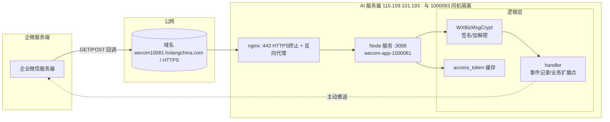

# 企微自建应用 1000081（HOLANG管理）回调服务 · 技术蓝图

> 编写：tech-lead（HOLANG 信息化总监·建设落地负责人）｜状态：**规划草稿（待落地方会签）**
> 复用判定：**B（改造复用）**｜服务目录：`wecom-app-1000081/`

---

## 1. 背景与目标

- **应用 1000081** = HOLANG管理（角色权限应用），需具备接收并响应企业微信事件与消息的回调后端。
- 现有 `wecom-callback/` 服务是**另一应用 1000083（HOLANG AI / WorkBuddy 企业版，ai.holangchina.com）**，跑在 AI 服务器 `115.159.101.193`。1000081 与它在**同机隔离部署**（独立目录/端口 3008/进程/PM2/nginx 站点），互不干扰。
- **目标**：独立、可部署、参数化的 1000081 回调服务，复用已验证的加解密与 token 逻辑，绝不影响既有 AI 服务。

---

## 2. 架构图

**关键隔离**：1000081 服务独占端口 3008 与独立进程/独立目录/独立 PM2/nginx 站点，与 1000083（AI 服务）**同机隔离部署**，互不共享进程、端口、文件，不影响 `ai.holangchina.com`。

---

## 3. 模块边界与复用判定

| 模块 | 来源 | 判定 | 说明 |
|------|------|------|------|
| `crypto.js`（WXBizMsgCrypt） | 复用 `wecom-callback/src/crypto.js` | **A 直接复用** | 算法与企微官方一致，已验证正确；内联副本保证部署隔离 |
| `getAccessToken` 缓存 | 复用 handler 模式 | **A 直接复用** | 2h 有效期 + 提前 5min 刷新 |
| `config.js` 参数化 | 改造 | **B 改造复用** | 改为 1000081 专属 env（端口 3008、agentId 1000081） |
| `index.js` 路由/绑定 | 改造 | **B 改造复用** | `0.0.0.0` 绑定 + `/wecom/1000081/callback` 专属路由 |
| `handler.js` 业务逻辑 | 新建 | **C 新建（最小）** | 1000081 通用安全处理器 + 业务扩展点 |
| 部署（nginx/PM2/.env） | 新建 | **C 新建** | 独立 nginx 站点 + PM2 实例 |

---

## 4. 接口契约

### 4.1 GET `/wecom/1000081/callback`（URL 验证）
- 入参（query）：`msg_signature, timestamp, nonce, echostr`
- 逻辑：`verifyURL` → SHA1 验签 → AES 解密 echostr → 返回明文（text/plain）
- 失败：HTTP 403

### 4.2 POST `/wecom/1000081/callback`（消息接收）
- 入参（query）：`msg_signature, timestamp, nonce`；body：XML（加密）
- 逻辑：验签 → 解密 → `parseStringPromise` → `handleMessage` → 被动加密回复 / 空串
- 响应：200 + 加密 XML（需回复时）或 200 + 空串（已处理/异常）
- **超时约束**：5 秒内必须响应，否则企微重试

### 4.3 GET `/health`
- 返回：`{"status":"ok","app":"wecom-app-1000081","agentId":1000081,"corpId":"..."}`

---

## 5. 与企业微信服务端交互逻辑

| 能力 | 实现 | 文件 |
|------|------|------|
| 签名验证 | SHA1(token+timestamp+nonce+encrypt) 字典序拼接 | `crypto.js:signature` |
| 消息加解密 | AES-256-CBC，Key=Base64(AESKey+'=')，IV=前16字节，PKCS7(块32) | `crypto.js` |
| Token 获取 | `gettoken` 接口 + 内存缓存（提前5min刷新） | `handler.js:getAccessToken` |
| 主动推送 | `message/send` 客服消息接口 | `handler.js:sendTextMessage` |
| 用户身份 | `user/get`（由 FromUserName 取姓名等） | 扩展点预留 |

---

## 6. 代码规则（遵循公司分层/类型/日志规范）

- 纯 Node ESM + Express4，无 TS（与现有 wecom-callback 一致，降低部署摩擦）；
- 密钥**仅 env**，启动 `checkConfig()` 缺项即退出，杜绝空配置上线；
- 结构化审计日志（who/event/when），对齐 H-2 审计要求；
- 异常一律返回空串，避免企微重试风暴；
- 禁止在代码中硬编码 Secret/Token/AESKey。

---

## 7. 验收标准（可复核/可审计）

| 项 | 标准 | 验证方式 |
|----|------|----------|
| 启动自检 | 缺密钥拒绝启动 | 故意清空 .env 一项 → 进程退出码 1 |
| 加解密 | 与企微官方样例互验通过 | 企微后台"回调配置"GET 验证 |
| 签名 | GET/POST 签名一致 | 企微发起验证/推送 |
| Token | 缓存生效、过期自动刷新 | 日志 + 接口调用 |
| 隔离 | 不影响 1000083/AI 服务 | 部署前后 `ai.holangchina.com` 可用性核对 |
| 回滚 | 预案可达、备份存在 | 演练 stop/还原 |

---

## 8. 待刘总确认 / 拍板项

1. **D1–D4（部署钥匙与门牌号）**：1000081 真实凭证、目标服务器、HTTPS 域名、可信域名登记 —— **阻塞实际上线**。
2. **业务意图**：1000081 是否需要"回复员工消息"？当前默认仅事件记录 + 安全空回；若需对接 OA 待办/权限提醒，在 `handler.js:handleBusinessMessage` 挂接（已留扩展点）。
3. **部署通道**：建议腾讯云 TAT（免 SSH 私钥，符合刘总"部署交数字员工"授权）；若用 SSH 需提供可达凭证。

> 本蓝图未落地前标注「草稿 / 待会签」；代码已可本地 `npm start` 自测 crypto 与路由，真实企微联调待 Gate 4。
